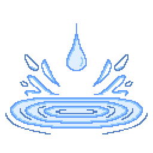

<div align="center">



# Ripple

**Make your shell more fluid.**<br>
Shader-based transitions for GNOME Shell menus, the wallpaper and the lock screen.

<p>
  
  <a href="LICENSE.txt"></a>
  <a href="https://github.com/nick-redwill/Ripple/stargazers"></a>
  
</p>

<p>
  <a href="https://github.com/sponsors/nick-redwill"></a>
</p>

<p>
  <a href="#features">Features</a> •
  <a href="#installation">Installation</a> •
  <a href="#requirements">Requirements</a> •
  <a href="#todo">TODO</a> •
  <a href="#support">Support</a>
</p>

</div>

---

> [!WARNING]
> **This is the `experimental` branch.** It aims to solve issues present in the current stable version while improving performance and compatibility with older GNOME versions.

## Features

| | Feature | |
|:-:|---|---|
| 💬 | **Menus & popups** | Animates every panel menu, Quick Settings, the calendar and context menus when they open and close |
| 🖼️ | **Wallpaper** | Animates wallpaper changes, by animating the old wallpaper away, like GNOME does, or the new one in |
| 🔒 | **Lock screen** | Animates locking and, optionally, unlocking |
| ✨ | **Built-in effects** | Burn, dissolve, glitch, melt, page curl, iris, ripple, tiles, wipe and zoom blur |
| 🎲 | **Per-module effects** | Pick which effects each part of the shell uses, or let Ripple choose randomly from all of them |
| ⏱️ | **Adjustable timing** | Set the duration of each kind of transition |
| 🛠️ | **Effect editor** | Write your own effects in GLSL right in the preferences and preview them instantly |
| 📁 | **Plain text effects** | Effects are simple `.ripple` files that reload as soon as you save them and are easy to share |
| 🖱️ | **Mouse-aware effects** | Effects can start from where the pointer is |
| 🔋 | **Battery saving** | Optionally falls back to the default animations when running on battery |

## Installation

**1. Clone the repository**

```bash
git clone -b experimental https://github.com/nick-redwill/Ripple.git
```

**2. Copy it to your extensions folder**

```bash
cp -r Ripple ~/.local/share/gnome-shell/extensions/ripple@nick-redwill
```

**3. Log out and back in, then enable the extension**

```bash
gnome-extensions enable ripple@nick-redwill
```
**4. Enjoy beautiful effects** 🎉

## Requirements

- **GNOME Shell 46+**

## TODO

- [ ] Add basic syntax highlighting to the editor
- [ ] Add animations for windows (like Burn my Windows), workspaces and overview (if there's demand)
- [ ] Find a way to show shader errors in the editor
- [ ] Add support for custom textures (base64 inside the .ripple files)

## Support

If you enjoy this extension, consider supporting its development.

<p align="center">
  <a href="https://github.com/sponsors/nick-redwill">
    
  </a>
</p>

You can also donate with crypto:

**Bitcoin (BTC)**
```
bc1qw6eclug78e2fhx6g5kk88mljcsf4l48y8sxg02
```

**USDT (TRC20)**
```
TFk1UM72jCXCVX53hbVoncFp5k8bVGbhAe
```

## Development

This project is developed with the assistance of AI tools. All changes are planned or approved by the author, and all AI-generated code is reviewed and tested before it is merged.

## License

Released under the [GPL-3.0](LICENSE.txt) license.
